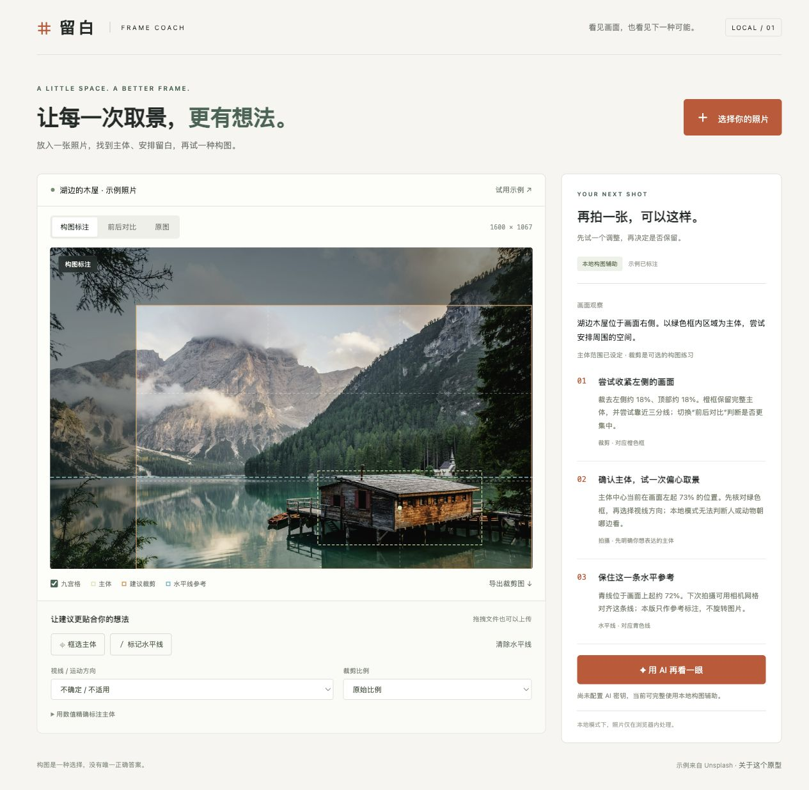

# 留白 · AI 摄影构图教练

一个以“下一张怎么拍”为目标的本地 MVP。上传照片，确认主体，得到三条具体建议，用标注和裁剪对比判断是否值得采纳。



项目维护方式和修改入口见 [CONTRIBUTING.md](CONTRIBUTING.md)。

## 现在就试

最省事：直接双击 **留白-本地体验.html**，即可在浏览器里离线使用上传、标注、裁剪、对比和导出，无需服务或安装依赖。这个单文件模式不连接 AI。

需要 AI 功能或继续开发时，这台电脑已有 Python 3，无需安装依赖。Mac 上双击 **启动.command**，浏览器会自动打开。保持终端窗口打开；关闭窗口或按 Ctrl+C 即停止服务。启动器自动选择空闲端口，可以重复启动。

如果要在终端启动：进入此文件夹后运行 `python3 launch.py`。需要固定地址时运行 `python3 server.py --port 8765`，打开 <http://127.0.0.1:8765>。

不要直接双击 `dist/index.html`：浏览器的本地文件限制会阻止模块加载，需要使用上述本地服务。

## 第一次体验的顺序

1. 先切换示例照片的“构图标注 / 前后对比 / 原图”，理解橙色裁剪框与绿色主体框。
2. 上传一张自己的 JPEG、PNG 或 WebP，最大 20 MB、4000 万像素。HEIC 请先转换为 JPEG。
3. 本地视觉焦点只是候选。点击“框选主体”，在照片上拖一个完整矩形；也可用数值输入主体范围。
4. 如果有人物视线或运动方向，选择朝左或朝右。静物选择“静物 / 没有方向”；不确定可以不设。
5. 选择比例，查看三条建议和前后对比。没有合适裁剪时保留原图，不强行切掉主体。
6. 青色线是水平参考。低置信度候选需要核实；可清除或点击“标记水平线”沿真实参照线拖动。Esc 取消标注。
7. 点击“导出裁剪图”得到 JPEG。原照片不会被修改，输出不包含辅助线。

## 启用真正的 AI 看图

双击 **启用AI.command**，在终端里输入你自己的 OpenAI API 密钥。输入不回显，也不会写入项目文件或浏览器。无需把密钥发到聊天中。然后在页面里点击“用 AI 再看一眼”。

也可以通过当前终端进程的 `OPENAI_API_KEY` 环境变量配置，再运行 `python3 launch.py`。`OPENAI_MODEL` 可覆盖默认的 `gpt-4.1-mini`；模型需同时支持图片输入与结构化输出，账户也需要对应权限。API 使用可能产生费用。

AI 输出包括主体矩形、视线方向、可信的水平线或空值、画面观察以及两条场景建议。应用再根据主体和所选方向计算裁剪，合计展示三条建议。手动确认的主体与明确设置的方向优先。修改参数后重算本地建议，并清除先前的 AI 文案，避免建议与标注不一致。

仅在点击 AI 按钮时，压缩后的 JPEG 被发送到 OpenAI。照片最长边缩至 1400 像素，以控制传输量；通过浏览器 Canvas 重编码，不包含原照片的 EXIF 元数据。密钥只在本地服务进程中使用，不返回前端。应用不保存上传照片，也不记录图片、密钥或 AI 内容。请求使用 `store: false`，这不等同于对提供商所有数据保留政策的承诺。

本地辅助模式没有照片外传，示例照片随项目提供，无需联网下载。

## 技术选择与边界

- **原生 HTML / CSS / JavaScript + Canvas**：无前端框架、无打包步骤，便于直接改界面和构图规则。
- **Python 标准库小服务**：托管本地页面并转发可选的 AI 请求。没有数据库、账户系统、复杂后端或第三方运行依赖，只监听 `127.0.0.1`。
- **本地辅助不冒充 AI 识别**：颜色对比和边缘估计给出焦点 / 水平线候选，不理解物体含义，不自动推断视线。候选区域尺寸是初始化值，必须由用户核实。
- **裁剪规则可检查**：在给定比例下搜索候选框，优先保留完整标注主体及小幅边缘余量，兼顾三分线与保留面积；朝右时倾向左侧三分线，朝左时相反。无法满足时退回原图并明确提示。
- **构图意图仍由摄影者决定**：三分法只是备选。居中、对称、负空间都可能更合适；当前没有多方案生成或审美评分。
- **水平线仅作参考**：可手动标记角度；本版不做自动旋转、不扩图、不承诺只凭单张照片判断相机该移动几步。
- **图像尺寸**：工作图最长边保留至 2600 像素，预览最长边 1400，导出基于工作图裁剪，最长边至 2600，并非原始全分辨率输出。
- **会话内体验**：刷新会回到示例，不保存项目历史。AI 超时、额度不足、返回无效坐标时显示错误，继续使用已有的本地标注。

没有加入实时相机、登录、云端存储、图库管理。这版先验证一个核心问题：建议是否真的帮你把下一张拍得更明确。

## 文件说明

- `dist/index.html` / `style.css`：界面和响应式布局。
- `dist/app.js`：上传、标注交互、AI 请求、状态与导出。
- `dist/core.mjs`：本地分析、裁剪几何与建议规则。
- `server.py`：本地服务、AI 提示词、JSON Schema、输入和模型结果校验。
- `留白-本地体验.html`：可直接双击打开的离线单文件版。修改源文件后运行 `python3 build_standalone.py` 重新生成。
- `launch.py`：自动选择端口、打开浏览器、可选安全输入密钥。
- `tests/`：裁剪和分析逻辑测试、AI 请求合同和异常路径的模拟测试。

## 验证记录

2026-11-05 完成：

- 6 项 JavaScript 测试通过，其中包括 1500 组确定性随机构图检查，覆盖主体不越界、不被裁断、可行时满足宽高比。
- 5 项 Python 测试通过：无密钥、无效图片、模型坐标校验、模拟 Responses 请求与手动设置优先、模型拒绝。
- 13 项本地 HTTP 检查通过：页面和资源、模块 MIME、AI 配置、错误格式、非本机 Host / 跨来源拒绝、源文件不暴露。
- 实际浏览器验证：上传照片触发本地分析；拖拽与数值主体标注；方向和比例联动；前后对比；九宫格；水平线手动标记；JPEG 导出；无密钥提示；窄屏布局。
- 浏览器导出的正方形 JPEG 已用图像工具确认格式和尺寸为 1067 × 1067。
- 离线单文件已生成并完成脚本语法检查；当前预览工具仅允许 HTTP / HTTPS，阻止打开本地文件，因此没有在该工具内验证直接双击 HTML 的运行效果。浏览器交互验证针对本地服务版。
- **当前未配置真实 API 密钥，AI 请求仅完成模拟测试，没有验证真实模型对照片的判断质量或在线端到端调用。**

在项目目录重新运行逻辑检查：

```sh
node --test tests/core.test.mjs
python3 -m unittest discover -s tests -p 'test_*.py'
```

日常运行不需要 Node；Node 仅用于执行上述 JavaScript 开发测试。

## 下一次一起做的验证

拿 3–5 张自己的照片，至少包含人像、风景、街拍。先确认主体，再逐条判断建议是否具体、是否有用、是否保留了你想表达的内容。配置密钥后，优先修正主体框、视线判断和不切断人物的能力，再考虑实时取景。

## 参考

AI 接口按 [OpenAI 官方图片理解文档](https://developers.openai.com/api/docs/guides/images-vision) 与 [结构化输出文档](https://developers.openai.com/api/docs/guides/structured-outputs) 实现。默认模型能力见 [GPT-4.1 mini](https://developers.openai.com/api/docs/models/gpt-4.1-mini)。

示例照片：[Unsplash 图片来源](https://images.unsplash.com/photo-1470770841072-f978cf4d019e)，仅用作构图体验。[Unsplash 许可](https://unsplash.com/license)。示例主体和水平参考已人工预标注；重新上传相同图片会执行通用本地估计，并非预标注结果。
